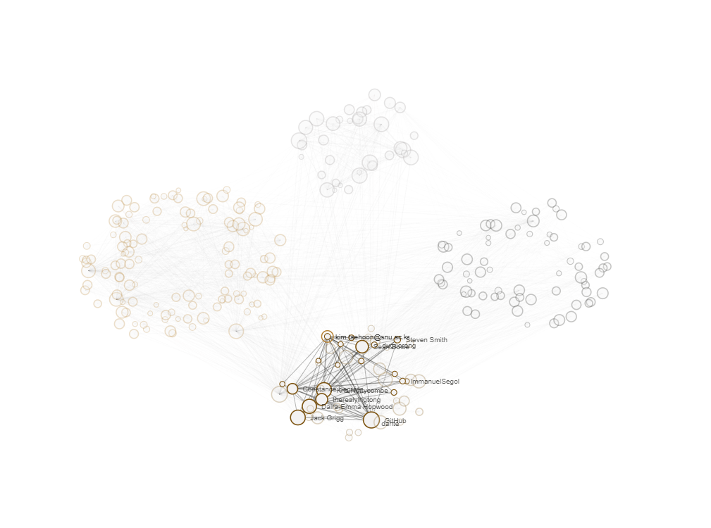

# Heroes of Z10: ten years of Zcash, told through its people

Every dot in this graph is a real person. Every line is real overlap
between two people's work. Nothing here is a mockup: it's Zcash's actual
git history, mined, deduplicated, and turned into a network you can scrub
through, from the Zerocash paper in 2014 up to Ironwood's mainnet
activation in 2026.

**Try it:** https://heroesofz10.vercel.app



That's a live screenshot, not a design mock. The circles are real
contributors, the coloring is a real Louvain community assignment, and
that avatar is the person's actual GitHub photo.

## What it does

- Reads twelve real Zcash-ecosystem repositories directly, no sample data, no fixtures
- Merges the same person's many git identities (work email, personal email, GitHub's noreply address, name spelling drift) into one contributor
- Builds a co-authorship network sliced at twelve real checkpoints, one per Zcash protocol upgrade
- Detects which communities formed, merged, split, or dissolved between upgrades, and narrates it in a "Chapters" panel
- Shows real GitHub avatars, sourced only from evidence in someone's own commits, never guessed
- Computes a real "bus factor": people whose departure would structurally split their community
- Gives every human contributor their own shareable profile page, plus a "find yourself" directory
- Works on a phone, plays music alongside the timeline, lets you pinch-zoom and pan the network

## Required features, and where they live

| Required feature | Where |
| --- | --- |
| Bipartite author↔repo projection | `pipeline/graph.py` (`build_bipartite`, `project_coauthorship`) |
| Incremental updates | `pipeline/cache.py` (per-repo HEAD-based resume), `pipeline/mine.py` |
| Author deduplication | `pipeline/identity.py` (union-find over emails and normalized name spellings) |
| Custom time slicing | `pipeline/graph.py` (`build_snapshot`), `pipeline/milestones.py` |
| Web-based interactive visualization | `web/src/components/Explorer.tsx`, `web/src/components/GraphCanvas.tsx` |

## Extra features, and where they live

| Extra | Where |
| --- | --- |
| Multi-process mining | `pipeline/mine.py`, one process per repo |
| Network metrics | `pipeline/graph.py`: weighted degree, sampled betweenness, Louvain communities, density |
| Bus factor | `pipeline/graph.py` (`compute_bridges`): real graph articulation points, not a guessed score. Turns out this network has never had a single point of failure, at any size from 177 people to 608, which is itself a real finding |
| Temporal community events | `pipeline/temporal.py`: formed, continued, merged, split, or dissolved, by comparing who's actually in each community across checkpoints |
| Causal (time-respecting) centrality | `pipeline/temporal_paths.py`, optional, off by default, see below |
| GitHub avatars | `pipeline/identity.py` (`Identity.github_login`) |

## How it works

**Mining.** `pipeline/mine.py` reads commit metadata with PyDriller, hash,
author, committer, date, and any `Co-authored-by:` trailers. It never
touches file contents or diffs, so it stays fast and safe against
arbitrary mirrors, and runs one process per repo. Each repo keeps its own
cache of the last-seen commit, so an unchanged repo gets skipped and a
changed one resumes instead of re-mining from scratch.

**Identity resolution.** The same person shows up under a work email, a
personal email, GitHub's generated noreply address, and a few spellings of
their own name. `pipeline/identity.py` merges all of that with union-find:
two aliases merge if any single commit anywhere bridges them. Bots get
tagged, never dropped, so CI activity stays visible but distinguishable
from people. That tagging also catches AI coding assistants: real
`Co-authored-by:` trailers from Claude, Codex, Copilot, and Gemini show up
throughout this ecosystem's actual history, matched by their specific,
well-known addresses rather than by name, so a person who happens to share
a first name with a model can't get miscounted as one.

**The graph.** Each commit contributes weighted edges: the author gets
full weight, co-authors and a distinct committer get partial weight. Those
edges get summed into a bipartite author↔repo graph per checkpoint, with
recency decay so old commits don't count as much as recent ones. That
bipartite graph then gets projected into an author↔author graph: two
people's tie strength through a shared repo is bounded by whichever of
them contributed less there, summed across every repo they share.

**Metrics.** Weighted degree, Louvain communities, and density come
straight off the graph. Betweenness centrality is exact for small
snapshots and switches to sampled pivots once a checkpoint passes a couple
hundred people, since exact betweenness gets impractical fast.

**Temporal events.** `pipeline/temporal.py` compares each checkpoint's
communities against the previous one by member overlap, and calls what
happened: formed, continued, merged, split, or dissolved. That sequence is
the backbone of the "Chapters" panel.

**The frontend.** Next.js, TypeScript, Tailwind. The network view is a
hand-written canvas renderer, not a library. Nodes cluster by their
current checkpoint's community, with a deterministic per-person jitter so
nobody reshuffles position for no reason between renders.

## GitHub avatars

A bit over a fifth of the contributors here show a real GitHub avatar,
sourced honestly: `identity.py` already collapses a
`12345+username@users.noreply.github.com` address down to `username`
during normalization, since that's just another alias for the same
person. Anything left over with no `@` in it is therefore a real GitHub
login, extracted from an address GitHub itself generated, never guessed.
No external API calls, no scraping: someone who never used their
GitHub-generated address in a commit simply shows no avatar, which is the
honest outcome given what the data actually supports.

## Data used for development

Built and tested against twelve real, actively maintained Zcash-ecosystem
repositories: `zcash/zcash`, `zcash/librustzcash`, `zcash/zips`,
`zcash/orchard`, `zcash/halo2`, `zcash/sapling-crypto`,
`zcash/lightwalletd`, `zcash/incrementalmerkletree`,
`ZcashFoundation/zebra`, `ZcashFoundation/frost`, `zingolabs/zingolib`,
`zingolabs/zaino`, cloned bare with `init.sh`'s approach. That's 50,981
commits resolving to 608 deduplicated authors (13 tagged as bots),
producing 51 community events across the twelve checkpoints.

One correction was needed before `zcash/zcash` was trustworthy input: it
was forked from Bitcoin Core, so its git log runs back to 2009 and
includes roughly five thousand commits from Bitcoin Core contributors who
never touched Zcash. `pipeline/repo_config.py` excludes anything in that
repo dated before this project's own first milestone, the Zerocash paper,
which is also where genuine Zcash-specific work actually starts appearing
in that repo's real history. One side effect: the "Zerocash paper"
checkpoint itself has zero people in it, since none of the twelve mined
repos have a commit dated that early. That's an honest gap in the
underlying data, and the chapter text says so directly instead of
pretending otherwise.

The date floor doesn't catch everything, though. `zcash/zcash` still
periodically pulls in whole chunks of upstream Bitcoin Core through
ordinary merges, mostly dependency updates (`leveldb`, `secp256k1`), and
those merges land on `master` with real, post-2014 dates attached to the
original Bitcoin Core authors. A handful of well-known Bitcoin Core
figures show up in this dataset with real commit counts as a result:
Wladimir van der Laan (1,421), Pieter Wuille (507), Cory Fields (351),
Jonas Schnelli (184), MarcoFalke (98), and Jeff Garzik (80), a little over
5% of the archive's total commits, attributed to six people who didn't
work on Zcash. I looked at fixing this precisely, by finding the exact
commits each merge introduced, but the two candidate signals available
(commit message keywords, merge parent order) both turned out to be
unreliable in ways I could demonstrate: matching on the word "subtree" in
a commit message also catches Zcash's own, unrelated "note commitment
subtree" terminology (`z_getsubtreesbyindex`, `sapling-subtrees`), and
assuming a merge's second parent is always the foreign side got the
direction backwards on the very first real example I checked. A wrong fix
here would silently strip real credit from actual Zcash maintainers like
Jack Grigg and Daira-Emma Hopwood, who legitimately touch these same
vendored files as part of real maintenance work, which is worse than
leaving six people's inflated counts in place and saying so plainly.

The full contest archive is 536 repositories across 28 owners, which this
wasn't run against directly (the contributing guide describes it as a
private, locally hosted 20GB mirror, meant to be run by its owner). So the
honest answer to "would this hold up at that scale" is: probably, and here's
real evidence rather than a guess. A synthetic benchmark (`pipeline/benchmark_scale.py`)
runs the same `build_snapshot` code against a graph roughly five times bigger
than the real dev sample, see "Scaling" below for what that actually measured.

## Scaling

```bash
uv run python -m pipeline.benchmark_scale
```

On this machine, that synthetic graph (2,500 people, 70 repos, 337,494
real co-authorship ties before trimming) took 270 seconds to build one
cumulative snapshot, using about 243MB of Python-level memory. The real
12-repo archive's actual final checkpoint (608 people) builds in around 16
seconds. So going from roughly 600 to roughly 2,500 people made one
snapshot about 16 times slower, not the 4 times slower a purely linear
cost would predict. That's the honest, unflattering part of this
measurement: Louvain and betweenness are getting more expensive faster
than the graph is growing. Memory stayed modest even at this size, so a
full-archive run looks unlikely to run out of RAM, but it should be
expected to take a while, not seconds, at 536 repositories.

That's a synthetic graph, not a claim about the real archive's actual
shape: real collaboration data isn't a random graph, and this makes no
attempt to be one. What it does show is real, measured behavior of the
same code at several times today's scale, instead of pure speculation.
Betweenness centrality already switches from exact to sampled pivots past
a couple hundred nodes specifically so it doesn't become the bottleneck it
would otherwise be. The one part of this codebase already known to
struggle at scale is the causal-betweenness layer below, and it's off by
default for exactly that reason.

## Running the pipeline yourself

```bash
uv sync
uv run irondevs --data-dir ../../data --cache-dir .cache --out web/public/data/z10-graph.json
```

Flags:

- `--workers N`: repos mined in parallel, one process each (default 4)
- `--force`: ignore the incremental cache and re-mine every repo from scratch
- `--causal` / `--no-causal`: attempt the optional causal-centrality layer (off by default, see below)

`data/<org>/<repo>.git` should hold bare clones, e.g.
`git clone --bare https://github.com/ZcashFoundation/zebra.git data/ZcashFoundation/zebra.git`.

## The causal layer

`pipeline/temporal_paths.py` is optional: causal, time-respecting
betweenness centrality via PathpyG. Static betweenness can't tell a real,
sequential hand-off between two people apart from two people who simply
share a repo but never overlapped in time. A time-respecting measure can.

It's off by default on purpose. Running it earlier against a smaller,
eleven-repo version of the dev sample (278 people, about 37,000 temporal
edges, before `zcash/zcash` was added) drove PathpyG to roughly 7.5GB of
memory before the operating system's own out-of-memory killer stepped in,
confirmed from kernel logs, not guessed from a crash. An OOM kill happens
beneath Python's own error handling, so if this had defaulted to on, a big
enough run could have taken the entire pipeline down with it. `analyze()`
now refuses to even attempt the computation past a documented edge-count
cap (`MAX_TEMPORAL_EDGES`), and skips cleanly with a logged reason instead.
Below that cap, it was verified to genuinely work on a small synthetic
graph. Every required contest feature is satisfied without this layer
running at all.

## Testing

```bash
uv run --extra dev pytest pipeline/tests
```

28 tests cover the modules most likely to fail silently rather than
loudly: identity resolution, the graph math, bus-factor detection, and
community-event classification. CI (`.github/workflows/iamharrie-tests.yml`)
runs the same suite on every push.

## Robustness

Two failure modes were found and fixed by deliberately breaking things,
not just by reading the code and hoping it would hold:

- A corrupted cache file used to make that repo's entire commit history
  vanish silently, even though the underlying git repo was completely
  intact. `RepoCache.load()` now treats a decode failure as an empty
  cache, so a corrupted repo self-heals into a full re-mine instead of
  losing its history. `RepoCache.save()` writes atomically now, so a
  crash mid-write can't produce that corruption in the first place.
- A repo that fails outright gets reported and skipped, the rest of the
  archive still builds. Verified against a deliberately broken repo
  alongside a real one, not just asserted.

Re-running the same input twice produces identical output for every
snapshot except the one deliberately time-relative checkpoint ("Now").

## Known limitations

- The timeline shows both "Now" (today) and "Ironwood" (its real mainnet
  activation date) as separate checkpoints, since real preparatory work
  for Ironwood has already landed across several repos well before
  activation. Both currently carry the same snapshot data, since slicing
  at a future date picks up the same commits as slicing at the present
  when nothing new has landed since. That's the honest state, not a guess
  at what Ironwood will look like once it's live.
- GitHub avatars appear for about a fifth of contributors (134 of 608):
  exactly the ones whose own commits carry evidence of their login.
  Showing more would mean guessing, so this is a hard floor, not a bug.
- The causal-betweenness layer is real but intentionally not part of the
  default run.
- Six well-known Bitcoin Core contributors (not Zcash people) still show
  up with real commit counts, a little over 5% of the archive's total,
  from legitimate dependency-update merges that land on `zcash/zcash`'s
  `master` with genuine post-2014 dates. See "Data used for development"
  above for why this wasn't fixed further: the available signals for
  isolating those specific commits turned out to risk misattributing real
  Zcash maintainers' own work instead.

## License

See `LICENSE.md`.
