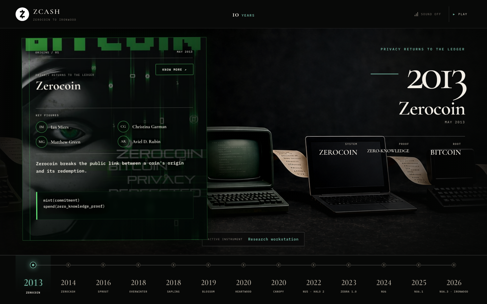

# From Iron to Code

An interactive, English-language archive of the Zcash story from Zerocoin in
2013 to the Ironwood network upgrade in 2026. The interface treats every era as
a writing instrument: research cards become paper, paper becomes terminal
glass, and the final chapter becomes a compact multi-agent CLI.

**Live demo:** [michae2xl.github.io/zcash10years](https://michae2xl.github.io/zcash10years/)



## What it does

- Presents 13 navigable chapters from Zerocoin and Zerocash through Sprout,
  Sapling, Halo, Zebra, NU6, NU6.1 and Ironwood.
- Animates each chapter as code being typed on a period-appropriate machine.
- Evolves the document surface from kraft paper and archival stock to CRT,
  terminal and agent-console interfaces.
- Includes source links, official marks where available, key people and compact
  aggregate counters for every chapter.
- Provides optional synthesized typewriter, keyboard, bell and impact audio
  without shipping audio files.
- Ends with a full-screen Ironwood reveal after the July 28, 2026 chapter.
- Supports keyboard navigation, reduced motion, mobile layouts and static export.

## Scope and data note

This submission is a curated visual narrative and presentation layer. Milestone
metadata and aggregate counters are currently embedded in `app/page.tsx`; it
does not mine or transform the contest's `data/` repository archive. Every
chapter links to its public source so the chronology remains inspectable.

## Run locally

Requires Node.js 22.13 or newer.

```bash
cd projects/Michae2xl
npm install
npm run dev
```

Open [http://localhost:3000](http://localhost:3000).

## Build the static site

```bash
npm run lint
npm run build
npm run start
```

The static export is written to `out/` and served locally by the last command.
To host below a URL prefix, set `NEXT_PUBLIC_BASE_PATH` while building:

```bash
NEXT_PUBLIC_BASE_PATH=/zcash10years npm run build
```

## Project structure

- `app/page.tsx` — chronology, interactions, generated sound and finale.
- `app/globals.css` — visual system, evolving paper/terminal surfaces and motion.
- `public/upgrades/` — transparent network-upgrade and Zebra marks.
- `public/editorial/` — source imagery for the Zerocoin and Zerocash chapters.
- `docs/hero.png` — current browser capture of the opening chapter.

## License

The application code is MIT licensed. See `LICENSE.md` and
`ASSET_NOTICES.md` for third-party marks and reference imagery.
