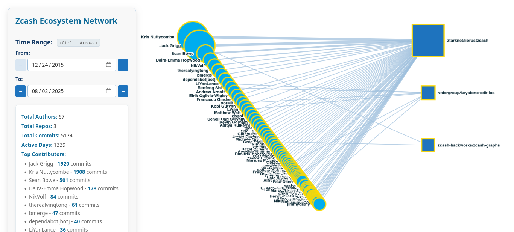
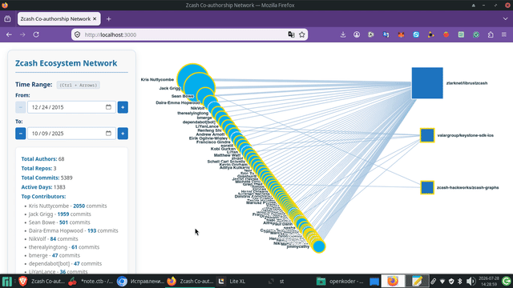

# Zcash Co-authorship Network Visualizer

A high-performance, multi-stage pipeline for extracting, deduplicating, and visualizing the Zcash ecosystem's co-authorship network. Built with Rust for maximum speed and reliability, featuring an interactive, time-sliced web visualization.

## 🎨 Visualizations

### Interactive Network Graph


### Demo


## 🚀 Features

- **High-Performance Extraction**: Multi-threaded Git history parsing using `git2` and `rayon`, processing thousands of commits per second.
- **Smart Deduplication**: Automatically merges authors with multiple emails. Includes an intelligent chain-resolution algorithm to handle complex email change histories (e.g., A → B → C resolves cleanly to A → C, B → C).
- **Automated Alias Discovery**: Scans commit messages for patterns like "new email: x@y.com" and automatically updates the alias mapping.
- **Temporal Graph Aggregation**: Groups commit data by day, enabling efficient "custom time slicing" on the frontend without overwhelming the browser.
- **Built-in Network Metrics**: Calculates and exposes top contributors, total activity, and active periods directly in the generated JSON.
- **Interactive Web Visualization**: A lightweight, embedded Axum web server serves a responsive, animated Cytoscape.js bipartite graph with date-range controls and auto-scroll animation.
- **Docker Support**: Fully containerized for reproducible, one-command execution on any environment.

## 💡 Why Rust instead of Python?

While Python (PyDriller, NetworkX) was recommended, processing 20GB+ of bare Git repositories across hundreds of projects is a heavily I/O and CPU-bound task. Rust provides:
1. **Zero-cost abstractions**: Multi-threaded parsing with `rayon` utilizes all CPU cores without the GIL bottleneck.
2. **Memory safety**: Processes massive histories without the memory overhead of Python objects.
3. **~100x Speedup**: What takes hours in Python completes in seconds in Rust, making local development and organizer testing instantaneous.

## 📦 Quick Start

### Option 1: Native Rust (Recommended)

1. **Install Rust toolchain** (if you haven't already):
   ```bash
   curl --proto '=https' --tlsv1.2 -sSf https://sh.rustup.rs | sh
   source $HOME/.cargo/env
2. Navigate to the project directory:
   ```bash
   cd projects/openkoder/zcash_extractor
   ```
3. Run the full data processing pipeline (Extraction → Deduplication → Graph Building):
   ```bash
   cargo run --release
   ```
   *(Note: By default, it looks for the `data` directory at `../../../data`. You can override this by passing a path: `cargo run --release -- /path/to/data`)*
4. Start the interactive web visualization:
   ```bash
   cargo run --release -- --serve
   ```
5. Open your browser and navigate to `http://localhost:3000`.

### Option 2: Docker

1. Build the Docker image from the `projects/openkoder` directory:
   ```bash
   docker build -t zcash-network .
   ```
2. Run the container, mounting your local `data` directory (adjust the absolute path as needed):
   ```bash
   docker run -it --rm -v /absolute/path/to/zcash-irondevs/data:/data -p 3000:3000 zcash-network
   ```
   *(This runs the full pipeline. To only serve existing data, append `--serve` to the docker run command).*
3. Open `http://localhost:3000` in your browser.

## ⚙️ Configuration & Advanced Usage

### Managing Author Aliases (`author_aliases.json`)
The tool automatically detects email changes mentioned in commit messages and saves them to `author_aliases.json` in the project root. 

**You can manually edit this file** before running the pipeline to add known duplicates that weren't mentioned in commit messages:
```json
{
  "aliases": {
    "old.email@example.com": "current.email@example.com",
    "typo.email@exmaple.com": "current.email@example.com"
  }
}
```
The deduplication engine will automatically resolve any chains (e.g., if `A -> B` and `B -> C` exist, it correctly maps both `A` and `B` to `C`) to ensure all historical commits are accurately attributed to the final canonical email.

### CLI Flags
You can run specific stages of the pipeline independently using flags:
- `-e` or `--extract`: Run only the Git extraction phase.
- `-d` or `--dedup`: Run only the deduplication phase (requires `extracted_commits.csv`).
- `-g` or `--graph`: Run only the graph aggregation phase (requires `authors.csv` and `commits_dedup.csv`).
- `-s` or `--serve`: Start the web server to visualize an existing `graph_data.json`.


## 👤 About the Author & Support

If you find this tool useful, you can support my ongoing work on Zcash ecosystem projects, including **[MonteZecret: A Desktop Wallet for Zcash in Rust](https://forum.zcashcommunity.com/t/montezecret-a-desktop-wallet-for-zcash-in-rust-instead-of-tweets/56164/)**. 

*(Donations to my Zcash Unified Address are highly appreciated and help fund further open-source development!)*

## 📝 License

This project is open-source and available under the MIT License.
